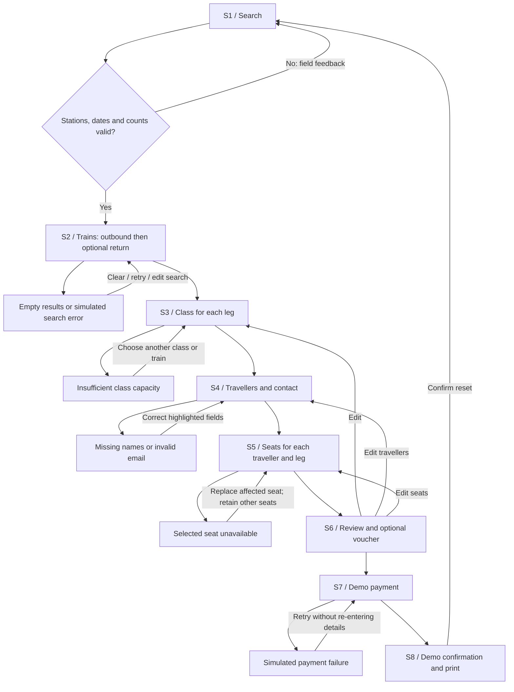

# Proposed IA and screen flow

**Proposed — awaiting card-sort validation.** No card-sort-derived structure can be claimed yet. The current pattern is sequential with Back and targeted Edit actions. It follows the supplied design preferences and keeps class selection before detailed traveller entry. Main navigation provides search and separate prototype guides.

Independent early wireframe: `/part-a/index.html`, version A.1. It remains grayscale and connected, with navigation to an error/recovery branch. It is preserved source, not a filter applied to the styled version. The functional Part B builds on the same sequence; no real Part A fixes were supplied to carry forward, so the team must reconcile them when collected.

Draft hierarchy notes for the team to review and rewrite in its own words: page heading identifies the task, card headings group a choice, then details explain the action. Proximity groups each traveller’s name and category. Common region bounds each journey and each class. Repetition places the primary forward action consistently at the end of the current task. Seat words/icons remain meaningful without colour.

Design evolution: upfront counts return with carry-forward to avoid duplicate input; class now precedes names; suggestions arrive selected and remain editable; Adults/Children replace the earlier senior-category concept. These are current choices, not validated findings. Fill the traceability below after real research.

| Requirement                                   | Implementation response                                                            | Evidence still required                                    |
| --------------------------------------------- | ---------------------------------------------------------------------------------- | ---------------------------------------------------------- |
| R1: ≥90% identify seat availability/selection | Free/Sold/Selected text, owner numbers, separate suggested star and details dialog | Moderated comprehension test                               |
| R2: ≥90% book three adults unassisted         | Count carry-forward, stable traveller cards, per-leg assignments                   | Real user task test; engineering check recorded separately |
| R3: mean confidence ≥4/5; nobody 1–2          | Explicit class benefits and full fares                                             | Real ratings; rank 0–3 omitted because unverified          |
| R4: distinguish states in grayscale           | Text, shape, check/cross and focus outline                                         | Team grayscale/POUR audit                                  |
| R5: ≥90% find Book within 30 seconds          | Prominent Search and selection bar / Book this train                               | Timed first-time-user test                                 |

| Card-sort evidence | Resulting IA change | Reason retained/changed | Version | Team owner |
| ------------------ | ------------------- | ----------------------- | ------- | ---------- |
| Pending            |                     |                         |         |            |
